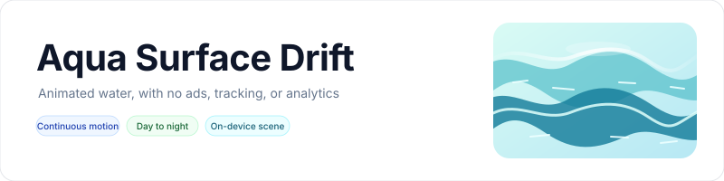
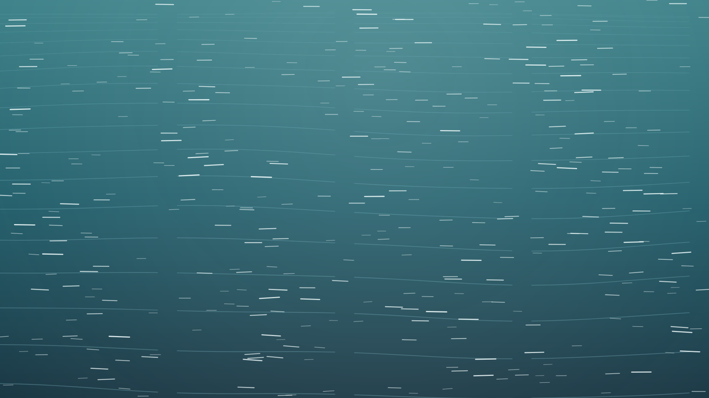
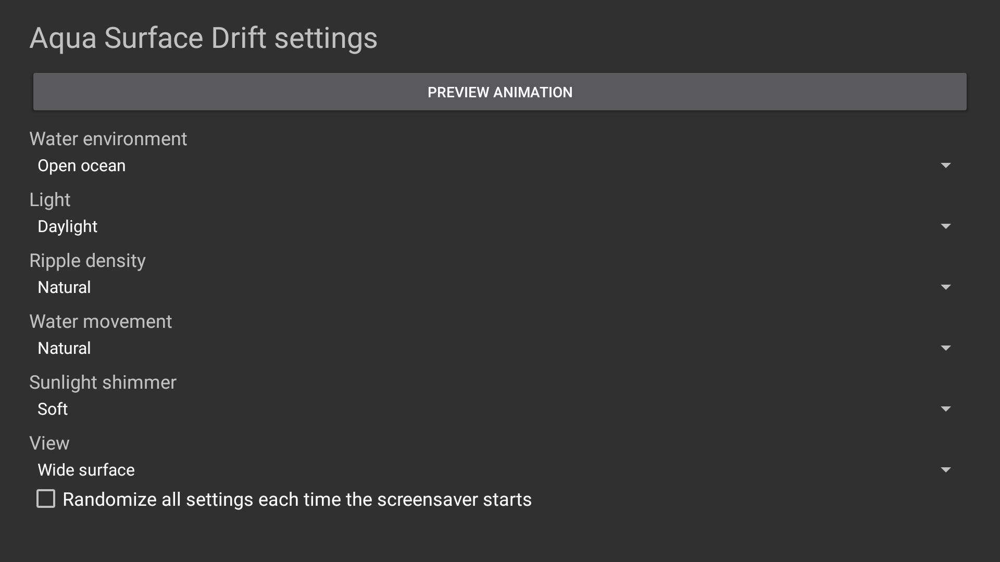

<p align="center">
    <picture>
        <source media="(prefers-color-scheme: dark)" srcset="art/banner-dark.svg">
        <source media="(prefers-color-scheme: light)" srcset="art/banner-light.svg">
        
    </picture>
</p>

<p align="center">A continuously moving water surface screensaver for Fire TV, Android TV, and Google TV.</p>

<p align="center">
<a href="https://github.com/jeremykenedy/aqua-surface-drift/releases"></a>
<a href="https://github.com/jeremykenedy/aqua-surface-drift/releases"></a>
<a href="https://github.com/jeremykenedy/aqua-surface-drift/actions/workflows/ci.yml"></a>
<a href="https://github.com/jeremykenedy/aqua-surface-drift/actions/workflows/style.yml"></a>
<a href="https://github.com/jeremykenedy/aqua-surface-drift/actions/workflows/docs.yml"></a>
<a href="https://github.com/jeremykenedy/aqua-surface-drift/actions/workflows/security.yml"></a>
<a href="LICENSE"></a>
<a href="https://github.com/jeremykenedy"></a>
<a href="https://github.com/jeremykenedy/aqua-surface-drift"></a>
<a href="https://github.com/jeremykenedy/aqua-surface-drift/stargazers"></a>
<a href="https://github.com/sponsors/jeremykenedy"></a>
</p>

## Table of Contents

- [Overview](#overview)
- [Privacy](#privacy)
- [Features](#features)
- [Device verification](#device-verification)
- [Requirements](#requirements)
- [Installation](#installation)
- [Fire TV Toolkit](#fire-tv-toolkit)
- [Configuration](#configuration)
- [Screenshots](#screenshots)
- [Building and testing](#building-and-testing)
- [Documentation](#documentation)
- [Release notes](#release-notes)
- [License](#license)

## Overview

Aqua Surface Drift renders a continuously shifting, close-up water surface with rolling ripples and optional sunlight glints. The scene is drawn locally with Android Canvas and includes no words, logos, or watermarked media.

## Privacy

The app has no ads, analytics, tracking, telemetry, crash reporting, or runtime network access. It requests no Android internet permission. The optional installer contacts GitHub only when you run it to fetch the latest APK and its SHA-256 file; it does not send device or usage information.

## Features

- Continuous animated water motion with ocean, lagoon, and pool color environments.
- Daylight, dusk, and night lighting choices.
- Calm, natural, or lively ripples, with adjustable motion speed and close or wide framing.
- Optional soft or bright surface shimmer; each setting can be randomized independently or together.
- Remote-friendly settings, full-screen preview, and a documented local settings-provider contract.
- Android DreamService and a standalone checksum-verifying ADB installer.
- No downloaded media, runtime network connections, ads, analytics, reporting, or tracking.

The Android view draws at the display size supplied by the system. It does not request or force a 3840x2160 rendering buffer. Native 4K behavior depends on the device and firmware and has not been verified on a physical 4K TV.

## Device verification

| Platform | Device and OS | Result |
| --- | --- | --- |
| Android TV emulator | `sdk_google_atv64_arm64`, Android 12/API 31, 1920x1080 | APK installation, settings UI, preview animation, and screenshot were checked. The emulator did not expose a system Dream picker, so idle activation was not verified. |
| Physical Fire TV | Not tested | We are looking for a Fire TV owner to test installation, screensaver selection and activation, remote settings, and wake/resume. Please report device model, Fire OS/API, resolution, tested behavior, and results in the [issue tracker](https://github.com/jeremykenedy/aqua-surface-drift/issues). |
| Physical Google TV | Not tested | We are looking for a Google TV owner to test installation, system selection and activation, remote settings, and wake/resume. Please report device model, OS/API, resolution, tested behavior, and results in the [issue tracker](https://github.com/jeremykenedy/aqua-surface-drift/issues). |

## Requirements

Aqua Surface Drift targets Android 6.0 (API 23) or later and requires a device that exposes Android DreamService screensavers. Availability and idle activation depend on device firmware and settings.

## Installation

Enable ADB debugging on the TV, connect over the network, then run:

```bash
adb connect TV_IP:5555
python3 install.py --serial TV_IP:5555
```

The installer downloads the latest release APK and its SHA-256 file from this repository, verifies the bytes, and installs or updates the app. It does not select the screensaver or change device timers. Open Aqua Surface Drift from the launcher to set options, then select it through the device's screensaver or ambient-mode settings.

Remove the app with `python3 install.py --serial TV_IP:5555 --uninstall`; unattended removal requires `--uninstall --yes --force`. See [installation](docs/INSTALLATION.md) for local APK, update, cancellation, and removal steps.

## Fire TV Toolkit

[Fire TV Toolkit](https://github.com/jeremykenedy/fire-tv-toolkit) has a guided terminal installer for supported Fire TV screensavers. After Aqua Surface Drift is added to its catalog, clone and set up the Toolkit, then install and select the saver:

```bash
git clone https://github.com/jeremykenedy/fire-tv-toolkit.git
cd fire-tv-toolkit
node setup.js

firetv-screensavers --install=aqua-surface
screensaver --set=aqua-surface
```

Run `firetv-screensavers --install=aqua-surface` again to update it. Remove it with `firetv-screensavers --uninstall=aqua-surface --force`. The Toolkit also manages Fire TV screensaver optimization and timeouts, the Alexa deep-sleep fix, its on-TV screensaver picker, optional AT4K launcher, and saved-setting restoration. Its optional Guard can restore selected settings after certain platform or app changes. Fire OS protects some updater packages, so it cannot prevent every system update. Toolkit features apply to supported Fire TV devices and do not establish device testing for this app or apply to Android TV and Google TV. Review the Toolkit [installation guide](https://github.com/jeremykenedy/fire-tv-toolkit#installation), [command reference](https://github.com/jeremykenedy/fire-tv-toolkit/blob/main/docs/COMMANDS.md), [Guard limits](https://github.com/jeremykenedy/fire-tv-toolkit/blob/main/docs/GUARD.md), and [revert guidance](https://github.com/jeremykenedy/fire-tv-toolkit/blob/main/docs/COMMANDS.md#reverting-and-removing).

## Configuration

Open Aqua Surface Drift from the TV launcher and use the remote. Values are stored locally and take effect when the DreamService starts. See [configuration](docs/CONFIGURATION.md) for option details and the settings-provider interface.

| Setting | Choices | Default |
| --- | --- | --- |
| Water environment | Ocean, Lagoon, Still pool, Random | Ocean |
| Light | Daylight, Dusk, Night, Random | Daylight |
| Ripple density | Calm, Natural, Lively, Random | Natural |
| Water movement | Slow, Natural, Quick, Random | Natural |
| Sunlight shimmer | Off, Soft, Bright, Random | Soft |
| View | Close surface, Wide surface, Random | Wide surface |
| Randomize all | On, Off | Off |

## Screenshots

These screenshots were captured from the running app on the Android TV emulator. The preview was left animating for 45 seconds before capture. The settings screenshot is separate from the scene.

<p align="center"></p>

<p align="center"></p>

## Building and testing

Build requirements are JDK 17 or later, Android SDK platform 36, build-tools 36.0.0, Python 3, and ADB for emulator checks. Run `bash build.sh` to create a locally signed APK. Then run:

```bash
bash test.sh
bash scripts/test-coverage.sh
bash scripts/test-python-coverage.sh
bash scripts/check-style.sh
python3 scripts/check-docs.py
python3 scripts/check-privacy.py
```

CI enforces 100% line and branch coverage for the scene-option resolver, water-motion math, settings validation, and installer code. Android framework rendering and DreamService lifecycle are verified on the emulator and by APK manifest checks. See [testing](docs/TESTING.md), [building](docs/BUILDING.md), and [CI](docs/CI.md).

## Documentation

- [Architecture](docs/ARCHITECTURE.md)
- [Building](docs/BUILDING.md)
- [CI](docs/CI.md)
- [Configuration and settings provider](docs/CONFIGURATION.md)
- [Installation, update, and uninstall](docs/INSTALLATION.md)
- [Release process](docs/RELEASING.md)
- [Testing](docs/TESTING.md)
- [Troubleshooting](docs/TROUBLESHOOTING.md)
- [Device verification](docs/VERIFICATION.md)
- [Security policy](SECURITY.md)

## Release notes

See [CHANGELOG](CHANGELOG.md) and the [latest release](https://github.com/jeremykenedy/aqua-surface-drift/releases/latest) for version details and upgrade instructions.

Show some love by starring this repository on GitHub. The badge links to the repository; visitors must click GitHub's Star control while signed in.

## License

Aqua Surface Drift is licensed under the [Apache License, Version 2.0](LICENSE). See [NOTICE](NOTICE) for required attribution notices.
